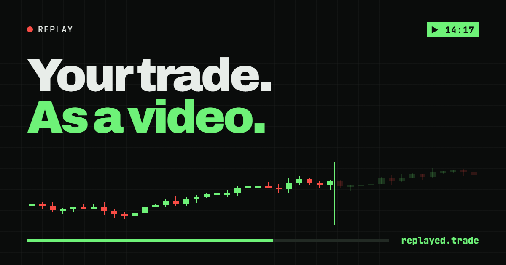
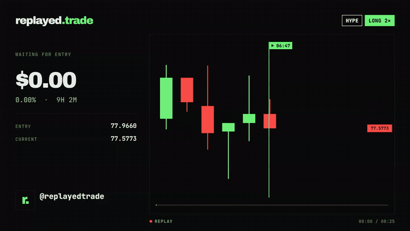
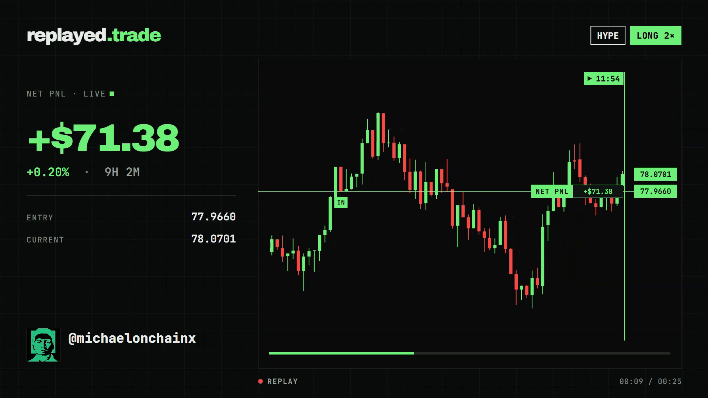
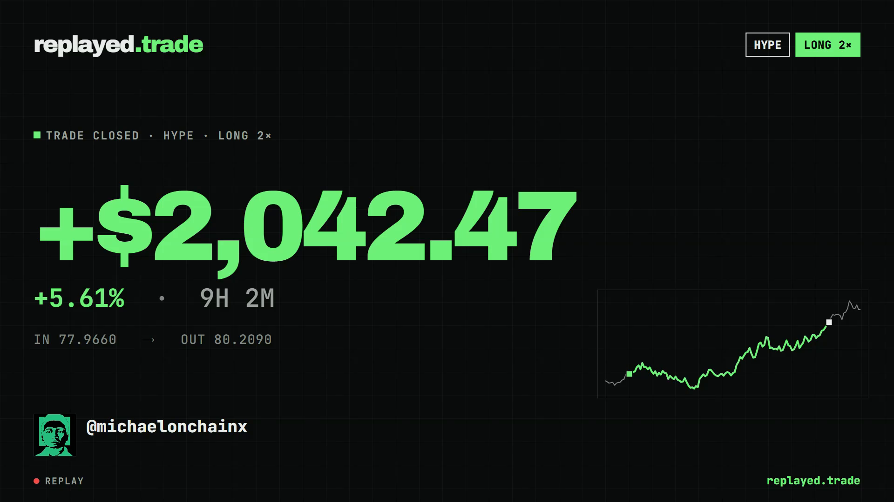
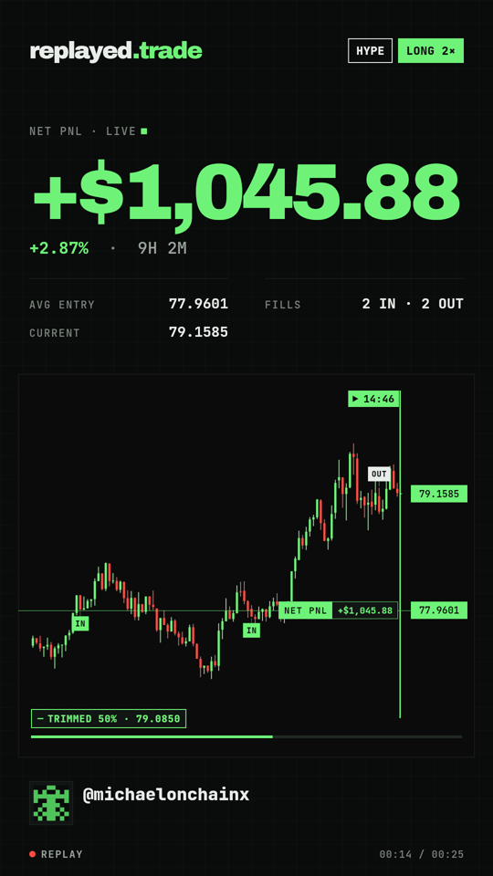

<p align="center">
  <a href="https://replayed-trade.vercel.app"></a>
</p>

<p align="center">
  <b>Screenshots show the result. Replays show the trade.</b><br />
  Pick a trade on the chart, get a broadcast-ready MP4. Rendered entirely in your browser.
</p>

<p align="center">
  <a href="https://replayed-trade.vercel.app"></a>
  
  
  
  <a href="../../actions/workflows/ci.yml"></a>
</p>

<p align="center">
  
</p>

## What it does

1. **Pick** the pair and click where you entered and exited on a live chart (Hyperliquid or Lighter prices). Add scale-ins and partial exits; size them in USD, margin or tokens.
2. **Style** it: your X handle pulls in your profile picture automatically; add a footer line, choose 16:9 or 9:16, 15/25/40 s.
3. **Export** a 1080p H.264 MP4 (or the final frame as PNG), copy a caption or a share link. Nothing is uploaded — the video is encoded on your machine.

<table>
  <tr>
    <td width="50%"></td>
    <td width="50%"></td>
  </tr>
  <tr>
    <td align="center"><sub>Live replay — the camera zooms out as candles print</sub></td>
    <td align="center"><sub>End card — the PnL counts up and slams in</sub></td>
  </tr>
</table>

<p align="center"></p>

## Highlights

- **Deterministic renderer.** One pure Canvas 2D function, `renderFrame(ctx, timeline, frame)`, drives the live preview, scrubbing, PNG and MP4 — frame N is pixel-identical everywhere (tested by hashing).
- **Precomputed timeline.** Intra-candle price paths (o→l→h→c), fills pinned at their exact price and time, live average-cost PnL, a spring-damped camera — all computed once, so playback is just a lookup.
- **Multiple entries & exits.** Scale-ins and partial exits sized in %, tokens or USD; PnL uses average-cost accounting with fees spread across executions.
- **In-browser MP4.** [Mediabunny](https://mediabunny.dev) + WebCodecs in a Web Worker with OffscreenCanvas, BT.709 limited-range I420 (`yuv420p`) so X, TikTok, Telegram and iOS accept it. ~12 MB for 25 s at 1080p30.
- **Brand system.** "Tape × Signal": Archivo 900 for the one huge number, JetBrains Mono for everything else, phosphor green `#6EF278`, red only for losses, square corners, 50 px grid.

## Stack

Next.js 15 (App Router) · TypeScript (strict) · Tailwind CSS v4 · zustand · zod · lightweight-charts v5 (picker) · Mediabunny / WebCodecs (export) · Vitest · Playwright · Vercel

## Run it locally

```bash
pnpm install
pnpm dev                 # http://localhost:3000
```

```bash
pnpm typecheck && pnpm test && pnpm build   # what CI runs
pnpm e2e                                     # Playwright smoke tests (after a build)
pnpm frames                                  # render comparison frames → reference/compare/
```

Requires Node 20+ and pnpm 11. Export works in Chrome, Edge and recent Safari (WebCodecs H.264).

## Deploy

Import the repo in Vercel — it's detected as Next.js and `vercel.json` sets pnpm. No environment variables are needed. Or from the CLI:

```bash
vercel deploy --prod
```

## Project layout

```
app/                 page, layout, API proxies (Lighter markets/candles, Hyperliquid fallback)
components/          UI — chart picker, executions table, customize, player, export bar
lib/render/          timeline.ts (precompute) · renderFrame.ts (draw) · layouts 16:9 / 9:16
lib/export/          Mediabunny encoder, worker, RGBA→I420
lib/fills.ts         multiple entries/exits, average-cost PnL
lib/hyperliquid/     market data (pairs + candles), lib/lighter/ likewise
tests/               Vitest unit tests + Playwright e2e
```

Design decisions and trade-offs are logged in [`DECISIONS.md`](DECISIONS.md).

---

<sub>Not financial advice. Not affiliated with Hyperliquid or Lighter. Charts by <a href="https://www.tradingview.com/">TradingView</a> Lightweight Charts™.</sub>
